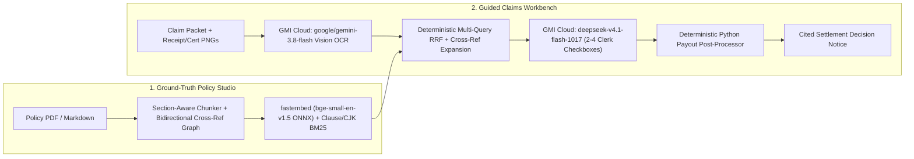

# ClausePilot

> **Turn $15/hr Support Clerks into Audit-Ready Travel Insurance Claims Adjusters**  
> Built for **YC RFS: The $15-an-Hour Expert** (`#the-15-an-hour-expert`)

---

## Why Naive "Chat-with-PDF" Fails Claims Operations

Travel inconvenience insurance (**旅遊不便險**) looks routine until an edge case hits. Unassisted support clerks and standard vector-search chatbots fail in two predictable ways:

1. **Clerks don't know which questions to prompt.** A licensed adjuster checks pre-announcement typhoon cutoffs (`Article 22.1`), first-available replacement flight boarding (`Article 22.2`), single-PNR conjunction ticket rules (`Section 21.4`), and inbound home-airport exclusions (`Article 27.2`). Giving a clerk a blank chat box produces rubber-stamped overpayments.
2. **Pure cosine top-K misses cross-referenced exclusions and sub-limits.** Searching *"overnight hotel and dinner during Tokyo flight delay"* retrieves coverage under `Section 24.1` while missing sibling sub-limits in `Section 24.3` (`$150/night` hotel cap; strict exclusion of alcoholic beverages like `生ビール`) or backward-linked exclusions like `Article 27.2` referencing `Article 26`.

---

## How ClausePilot Solves It



### Key Technical Pillars

| Layer | Implementation | Why It Matters |
| :--- | :--- | :--- |
| **Multimodal Evidence OCR** | `google/gemini-3.8-flash` on GMI Cloud + SHA-256 disk cache (`vision_cache.json`) & live re-scan | Reads bilingual English / Traditional Chinese / Japanese airline delay certificates (`班機延誤證明`) and itemized receipts (`定食`, `生ビール`). |
| **Hybrid + Cross-Ref Graph RAG** | Local `BAAI/bge-small-en-v1.5` ONNX (384-D) + dotted-clause/CJK `BM25Okapi` fused via RRF (`k=60`) + bidirectional & sibling graph | Automatically attaches `Section 24.3`, `Article 22`, and `Article 27.2` tagged as `cross_ref_expansion` so exclusions are never dropped. |
| **Sub-Second Guided Reasoning** | `deepseek-ai/deepseek-v4.1-flash-1017` on GMI Cloud (`reasoning_effort="none"`, JSON mode) | Generates 2–4 concrete clerk verification checkboxes in ~0.6s instead of an open-ended chat prompt. |
| **Deterministic Payout Engine** | Strict Python post-processor (`post_process_settlement`) | Locks canonical `claimed_usd`, enforces `0 <= approved_usd <= claimed_usd`, zeroes denied/escalated payouts, and computes exact **Leakage Prevented** or **Held for Senior Review**. |

---

## Pre-Seeded Taipei Demo Scenarios

1. **`CLM-8841` — Typhoon Kong-rey Return Delay (`NRT → TPE`, Starlux `JX805`)**
   - **Claimed:** `$567.00` (`$250` Fixed Delay Tier + `$240` Shinjuku Prince Hotel + `$55` Izakaya Set Dinner `定食` + `$22` Draft Beer `生ビール x2`).
   - **Result:** **Partial Approval — `$455.00` Paid / `$112.00` Leakage Prevented** (`Section 24.3` caps hotel at `$150.00` and rejects `$22.00` alcohol).
2. **`CLM-8842` — Inbound Home-Airport Baggage Delay Trap (`NRT → TPE`, EVA Air `BR197`)**
   - **Claimed:** `$340.00` emergency clothing & toiletries in Taipei after 15h baggage delay.
   - **Result:** **Claim Denied — `$0.00` Paid / `$340.00` Leakage Prevented** (cross-ref graph links `Article 26` → `Article 27.2` Home-Country Arrival Exclusion).
3. **`CLM-8843` — Split-PNR Missed Connection (`TPE → HKG → LHR`, `CI903` + `CX251`)**
   - **Claimed:** `$1,420.00` walk-up rebooking across two separate PNRs (`7K9X2A` & `M4P81Q`).
   - **Result:** **Escalated to Senior Licensed Adjuster — `$0.00` Clerk Payout / `$1,420.00` Held for Review** (`Section 21.4` Single-PNR Conjunction Rule).

---

## Quickstart

### Prerequisites
- Python `3.13` + [`uv`](https://docs.astral.sh/uv/)
- Node.js `20+` + `npm`
- `GMI_API_KEY` configured in `backend/.env`

### Launch Full Stack (`:8000` + `:3000`)

```bash
chmod +x ./dev.sh
./dev.sh
```

- **Guided Claims Workbench & RAG Studio:** [http://localhost:3000](http://localhost:3000)
- **FastAPI Interactive OpenAPI Docs:** [http://localhost:8000/docs](http://localhost:8000/docs)

### Run Automated Backend Verification Suite

```bash
cd backend
uv run pytest -v
```
